# La bible graphique de Cadastra

Ce document fixe **comment le jeu doit avoir l'air**, pour que chaque image, chaque écran et chaque effet produits ensuite restent cohérents. Il complète `docs/DESIGN.md` (les écrans, les couleurs, les polices : « la plaque et la pièce ») et sert de référence pour la phase des graphismes (`docs/PLAN.md`, phase 10).

Écrit le 3 novembre 2026, d'après les choix de Gautier. **Validé par Gautier le 3 novembre au soir** (la preuve « pack et cartes » : « Oui, on continue »).

## 1. Les choix de Gautier (3 nov. 2026)

| Question | Réponse |
|---|---|
| Par quoi commencer | **Le pack et les cartes** : la pochette du pack du jour, son ouverture, les cartes par rareté. C'est la preuve, avant de produire le reste. |
| Le rendu | **Jeu mobile coloré** : formes rondes, couleurs vives, gros reliefs, dans l'esprit de Clash Royale ou Brawl Stars. |
| Les outils | **Gratuits d'abord** : Claude dessine en code (SVG, CSS, Canvas, Three.js) ; on ne paie un outil d'image ou de 3D que si une preuve le demande, dans le budget de 20 € par semaine. |

Méthode (la même que pour l'Arena) : **une preuve complète, validée par Gautier, avant la série**. Personne ne dessine à la main.

## 2. Le style en dix règles

1. **Un contour sombre partout.** Tout objet dessiné (carte, pochette, bouton, icône illustrée, texte de titre) a un contour encre `#17233F`, épais : 3 px sur une carte de collection, 4 à 6 px sur une grande illustration. C'est ce qui donne l'allure « jeu mobile ».
2. **Des couleurs franches et saturées**, jamais grises ni pastel. Les couleurs du jeu restent celles de `DESIGN.md` (encre, plaque, cadre, pièce, brique, ciel), poussées vers le vif.
3. **La lumière vient d'en haut à gauche.** Chaque relief a un dessus clair et un dessous foncé : dégradé du clair (en haut à gauche) au foncé (en bas à droite), un reflet blanc en haut, une ombre pleine dessous (le « relief » des boutons : 3 à 5 px d'ombre sombre, sans flou).
4. **Des formes rondes et épaisses.** Coins arrondis (20 px sur une carte), traits épais, pas de détail fin qui disparaît sur un petit écran.
5. **Les titres en relief.** Les grands textes (PACK DU JOUR, les chiffres d'une carte) sont en Baloo 2 très gras, remplis d'un dégradé (or pour la monnaie et les titres), entourés d'un contour encre épais, avec une ombre pleine en dessous.
6. **Les rayons de soleil** derrière ce qui compte (le logo, l'icône d'un lieu célèbre, le monument) : des rayons clairs qui partent du centre, comme dans les jeux mobiles. Ils tournent lentement seulement pour les raretés les plus hautes.
7. **La pièce d'or en forme de maison** (`icones/piece.svg`) est l'emblème du jeu : sur le dos des cartes, sur la pochette, dans la monnaie.
8. **La plaque de rue émaillée** reste l'élément propre à Cadastra : le nom d'un lieu est toujours sur une plaque (DESIGN.md).
9. **Le mouvement récompense** : les effets bougent sur les cartes rares (reflet, étincelles, irisé), jamais sur les écrans de tous les jours ; tout s'arrête si le téléphone demande de réduire les animations.
10. **Lisible à 160 px de large** : une carte de collection doit se lire d'un coup d'œil sur un petit téléphone (le nom sur la plaque, la valeur en gros).

## 3. Les raretés : une échelle d'effets

Plus une carte est rare, plus elle brille. Chaque rareté garde sa couleur (`DESIGN.md`) ; les effets s'ajoutent de l'une à l'autre.

| Rareté | Cadre | Effets |
|---|---|---|
| Commun (ardoise) | anneau ardoise en relief | aucun |
| Peu commun (vert) | anneau vert en relief | aucun |
| Rare (bleu) | anneau bleu en relief | un reflet de lumière passe sur la carte de temps en temps |
| Épique (violet) | anneau violet en relief | reflet, et des étincelles qui scintillent aux coins |
| Légendaire (orange) | anneau orange en relief, halo doré | reflet, étincelles, et les rayons derrière l'illustration tournent lentement |
| Extraordinaire (arc-en-ciel) | anneau arc-en-ciel qui défile | tout ce qui précède, et une couche irisée (« holographique ») qui glisse sur la carte |

## 4. Les pièces de la preuve (pack et cartes)

### La carte (face)
- **Contour encre**, puis **l'anneau de la rareté** (6 px, dégradé du clair au foncé, lumière en haut à gauche), puis un **filet blanc** fin à l'intérieur.
- **L'étiquette de rareté** pend du haut de la carte, au milieu, comme un onglet : fond de la couleur de la rareté en relief, contour encre, texte blanc cerné d'encre.
- **L'illustration plein cadre** (« full art », décision de Gautier) : le mur de briques et la plaque de la voie pour une adresse ; le ciel de la rareté, ses rayons et l'icône pour un lieu nommé ou un monument.
- **Le bandeau du bas** : un dégradé encre, la valeur en gros chiffres or cernés d'encre, avec la pièce.

### La carte (dos)
- Bleu plaque vif, des rayons clairs depuis le centre, un double cadre (or puis encre) à l'intérieur du contour blanc.
- Au centre, **la pièce-maison en grand**, qui « respire » doucement ; en dessous, une petite plaque « Cadastra ».

### La pochette du pack du jour
- Un fond bleu vif avec de grands rayons depuis le logo, des pièces-maisons et des étincelles qui flottent.
- En haut, la **plaque « Cadastra »** ; au milieu, **PACK DU JOUR** en lettres d'or épaisses, cernées d'encre, en relief.
- Un **ruban rouge** (brique) : « 5 lieux · toute la France ».
- En bas, **une ville de dessin animé** : des immeubles crème aux toits bleu ardoise façon Paris, contours encre, fenêtres allumées, la tour Eiffel au milieu.
- Le reflet métallisé et irisé de la pochette (Three.js) reste par-dessus.

### La preuve en images (3 nov. 2026)

| La pochette (texture, avant le reflet 3D) | Le dos d'une carte | La collection (les six raretés) |
|---|---|---|
| 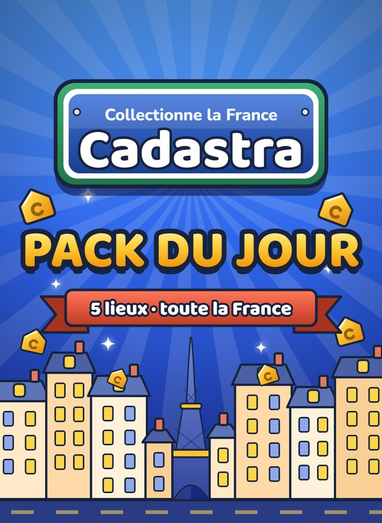 | 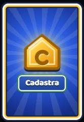 | 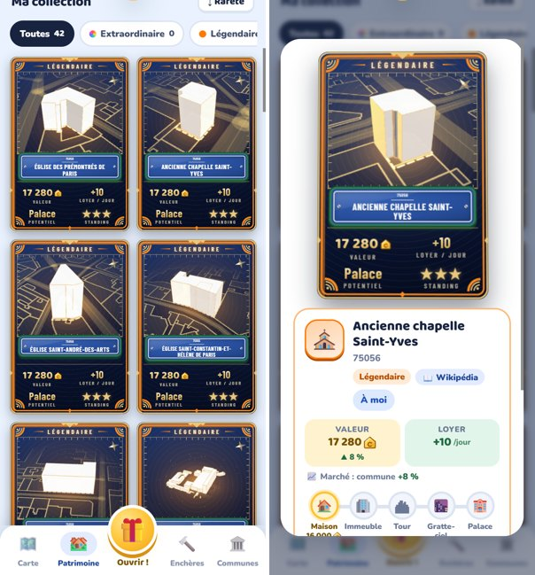 |

Où c'est dans le code : la pochette est dessinée par `makeArt()` (`index.html`, Canvas, posée sur la pochette 3D) ; la face d'une carte par `carteArt()` (le fond, le sujet, le bandeau, puis l'anneau `.cadre` et les effets `.reflet`, `.eclats`, `.holo`) ; le dos dans `sortirCartes()` (`.dos-piece`, `.dos-nom`) ; les styles à la fin de `style.css` (section « graphismes, la preuve »).

## 5. Ce qui viendra après la preuve (à valider dans l'ordre)

1. ~~L'ouverture : la déchirure qui suit le doigt, les cartes qui glissent du pack, les sons (phase 10.3).~~ Fait le 3 nov. (§ 7).
2. ~~Les monuments en 3D stylisée, la tour Eiffel d'abord (phase 10.4).~~ La preuve (la tour Eiffel) faite le 3 nov. (§ 8) ; les autres monuments ensuite, un par un, après validation.
3. L'habillage de la révélation façon FIFA (phase 10.5).
4. L'icône, le logo, l'écran d'accueil (phase 10.6).
5. Les illustrations par lieu (églises, mairies, châteaux…) si les icônes ne suffisent plus : ce serait le premier besoin d'un outil d'image par IA.

## 6. Comment on produit

- **En code d'abord** : SVG et CSS pour les cartes, Canvas pour la pochette (texture de la 3D), Three.js pour la 3D. Tout est versionné dans le dépôt, sans fichier lourd.
- **Un outil d'IA seulement si une preuve le demande** (une illustration qu'on ne sait pas dessiner en code) : Claude propose l'outil et son coût, Gautier crée le compte.
- **Chaque étape se vérifie au format téléphone** (375 × 812 et 360 × 780) avant d'être publiée, et se compare avec la version d'avant.

## 7. L'ouverture du pack (phase 10.3, 3 nov. 2026)

- **La déchirure suit le doigt** : on glisse le doigt sur le haut de la pochette, dans un sens ou dans l'autre ; le haut se soulève vers le joueur depuis le côté où le doigt a commencé (il tourne autour d'une charnière à l'autre bout), une étincelle et de petits éclats d'or suivent le point de déchirure, le téléphone vibre un peu à chaque cinquième du chemin. Arrivé aux 85 %, le haut s'arrache et s'envole. Si l'on lâche avant, il retombe. Un simple toucher sur le haut ouvre toujours le pack (pour qui ne veut pas glisser).
- **Les cartes glissent hors du pack** : elles montent une par une depuis l'ouverture (on ne voit que ce qui en est sorti), puis le pack tombe et disparaît.
- **Les sons**, synthétisés (aucun fichier) : un crépitement de papier métallisé pendant la déchirure, plus fort et plus aigu quand le doigt va vite ; l'arrachage ; un carillon à l'ouverture ; un souffle pour chaque carte qui sort. Ils suivent le réglage « Sons ».
- **La lumière** : la pochette ne bascule plus en arrière (face au « plafond » lumineux de la scène, elle devenait toute blanche) ; le projecteur est un peu adouci et le halo ne prend que les vraies lumières. Le pire cas mesuré n'est plus qu'un éclat dans un coin.
- Plus tard, si Gautier le veut : de vrais sons enregistrés (banques libres de droits, à télécharger avec son accord).

## 8. Les monuments en 3D (phase 10.4, 3 nov. 2026)

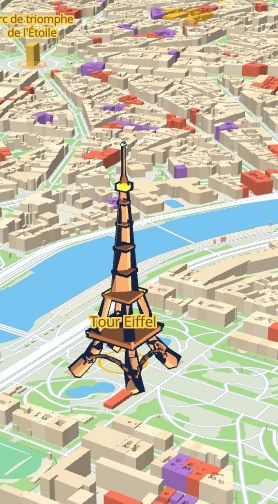

- **La preuve : la tour Eiffel**, posée sur la carte à sa vraie place, à sa vraie hauteur (330 m) et dans son vrai sens (orientation mesurée sur les blocs de la BD TOPO, que la maquette remplace).
- **Le style** : des formes simples et épaisses (quatre pieds courbes, les arches, deux plateformes bordées d'or, la flèche et ses ceintures, la loge dorée, l'antenne et un feu au sommet), des ombres franches à trois tons comme un dessin animé, une lumière douce d'en haut à gauche (sinon la pierre claire devient blanche), et **un contour encre** : 1,6 m de loin (1 à 2 pixels), 0,5 m de près (zoom 16,8 et plus).
- **Tout est construit en code** (Three.js, `src/maquettes.js`), sans fichier de modèle ; la maquette est une couche de la carte, sans animation : la carte se repose toujours.
- **Pour ajouter un monument** : une fonction qui construit sa maquette en mètres (y vers le haut), son centre et son orientation mesurés sur la BD TOPO, et les identifiants (`cleabs`) des bâtiments de l'IGN qu'elle remplace (`MODELES` dans `src/maquettes.js`). Un test vérifie qu'elle correspond à un monument de la liste.
- **Trois monuments de plus** (3 nov. 2026, les plus connus après la tour Eiffel) :
  - **Notre-Dame de Paris** : nef et chœur, toit de plomb bleu, bas-côtés, transept, abside, arcs-boutants, deux tours de 66 m, la rosace, les portails, la flèche (96 m) et son coq doré ;
  - **l'Arc de triomphe** : deux piliers, la grande arche en plein cintre, la frise, la corniche, l'attique, les arches des côtés, les groupes sculptés ;
  - **le Sacré-Cœur** : tout en pierre blanche, la nef en croix, le porche à trois arches et ses deux petits dômes, le grand dôme ovoïde et sa lanterne, quatre dômes autour, le campanile, des croix dorées.

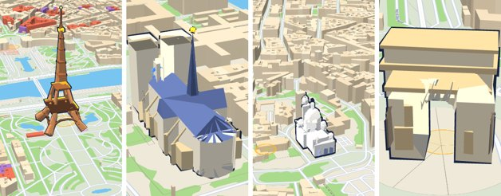

- **Ce qu'on a appris** (retour de Gautier : « de près, le bâtiment devient moche et perd ses couleurs ») : dans la couche de la carte, le sens des faces n'est pas fiable selon l'angle ; rien n'en dépend plus (chaque pièce se dessine des deux côtés, avec sa lumière vers l'extérieur ; le contour se dessine en premier et les pièces se posent par-dessus). Et **tout bâtiment de l'IGN qui tombe dans le volume d'une maquette doit être masqué** (la sacristie et les chapelles de Notre-Dame la perçaient) : vérifier en listant les bâtiments dont un point tombe dans le rectangle de la maquette.
- **Huit monuments de plus** (4 nov. 2026, la suite de la liste, les plus connus d'abord) : **Versailles** (la façade des jardins, la cour de Marbre en brique, les toits d'ardoise, la chapelle, la grille dorée), **Chartres** (toit de cuivre vert, ses deux flèches différentes), **Reims** (deux tours plates de 81 m), **Saint-Denis** (sa tour unique), **le Panthéon** (portique, colonnade, dôme), **l'Opéra Garnier** (coupole de cuivre vert, groupes et Apollon dorés), **la Concorde** (l'obélisque et son pyramidion doré, les deux fontaines), **le Pont du Gard** (trois rangs d'arches ; sur la carte plate, les piles descendent jusqu'au sol là où le rang du dessous s'arrête). Les cathédrales viennent d'un **modèle réglable** (`cathedrale()` : longueur, tours, flèches, couleurs) ; Notre-Dame en est un réglage. Pas de maquette pour les grottes (Lascaux, Chauvet) ni pour le Père-Lachaise : ils gardent leur halo doré.

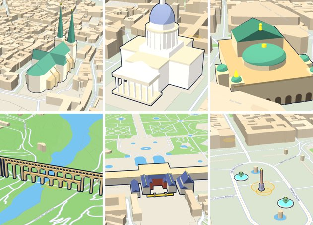

- **La vraie cause des défauts de près** (trouvée le 4 nov.) : la précision. Les objets portaient leurs coordonnées « mondiales » de la carte (un mètre y vaut 2,5 milliardièmes) ; la carte graphique calcule en simple précision et perdait positions et profondeurs à 2 m près : de près, le devant et le derrière se mélangeaient par plaques, des faces disparaissaient, les arêtes tremblaient. Maintenant chaque monument est dessiné en mètres autour de son centre, et sa place sur la carte entre dans la matrice de la caméra, calculée en double précision. Les autres précautions restent (dessin des deux côtés, contour d'abord, lumière douce, masquage).
- **Dix monuments de plus** (4 nov. 2026, la suite de la liste) : **les Invalides** (le Dôme doré et ses côtes, le tambour à colonnes, le portail à deux rangs de colonnes, la nef de Saint-Louis), **l'Élysée** (la cour d'honneur entre ses deux ailes, le perron et sa marquise, le portail sur la rue, le drapeau tricolore sur le toit), **la Sorbonne** (la chapelle, sa façade à colonnes, son dôme et ses quatre lanternons), **la Sainte-Chapelle** (les verrières bleues entre les contreforts, le toit très raide et sa crête dorée, la flèche de 75 m), **le Luxembourg** (les hauts toits d'ardoise, les pavillons, le pavillon d'entrée à dôme), **Fontainebleau** (la cour du Cheval-Blanc, l'escalier en fer à cheval, la grille ; le reste du château reste celui de l'IGN), **Chambord** (le donjon et ses tours rondes, la forêt de toits, de cheminées et de lanternons, la grande lanterne de 56 m), et trois cathédrales du modèle réglable, qui gagne des réglages (étage octogonal, tour-lanterne, couleur d'une flèche, pièces en plus) : **Amiens** (la plus haute nef de France, la fine flèche de 112 m), **Rouen** (la flèche de fonte de 151 m, la tour Saint-Romain, la tour de Beurre et sa couronne, les tours du transept), **Strasbourg** (le grès rose, la tour unique, son octogone et sa flèche de 142 m, le toit de cuivre).

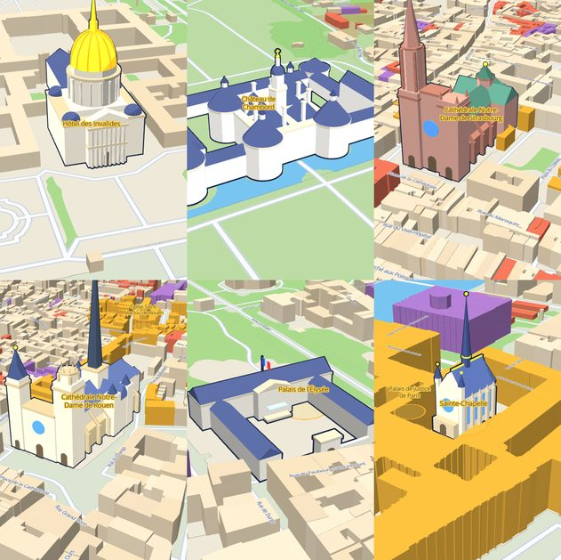

- **Les maquettes ne ralentissent plus la carte** (4 nov.) : Three.js recalculait la position de chaque pièce de chaque monument à chaque dessin, 22 fois par image ; les positions se calculent maintenant une seule fois, et un monument loin de l'écran n'est pas dessiné du tout. Mesuré sur le PC : 12 ms par image avant, 2,4 ms après, autant que sans maquettes.
- **Pour poser une maquette** : dessiner le plan des bâtiments de la BD TOPO dans le repère de la maquette (quadrillage de 10 m, hauteurs écrites) ; on y lit où vont les tours, le transept, les ailes. L'IGN ne donne pour l'Élysée qu'un contour simplifié (site sensible) : la maquette suit la rue et les rues voisines.
- **Six monuments de plus** (nuit du 4 nov. 2026, Gautier couché : « fais-en le maximum ») : **le Louvre** (la pyramide de verre et les trois petites, les ailes Richelieu et Denon et leurs pavillons à dôme carré, les cours couvertes de verre, la cour Carrée et sa Colonnade, la Grande Galerie jusqu'au pavillon de Flore), **le Mont-Saint-Michel** (le rocher de granit porte l'abbaye : la carte est plate ; la Merveille, l'église, la flèche et l'archange doré), **Carcassonne** (les deux enceintes et une cinquantaine de tours, à leur place et à leur hauteur : les murs et les tours viennent de la BD TOPO ; toits pointus d'ardoise pour les tours hautes, de tuiles pour les basses ; le château comtal, la basilique), **Chenonceau** (le logis sur ses piles, la galerie sur ses arches au-dessus du Cher, la tour des Marques), **le palais des Papes** (ailes crénelées, toits de tuiles, hautes tours, grandes arcades en ogive), **la Madeleine** (un temple grec de 48 colonnes).
- **Des pièces réunies** : une colonnade, des tours, des murs, des créneaux deviennent une seule forme (`fusion` dans l'atelier : `cylindres`, `cones`, `boites`, `toits`, `comblesN`, `remparts`, `creneaux`…), dessinée d'un coup par la carte graphique ; Carcassonne tient en une soixantaine de formes. De nouvelles formes : le dôme carré (pavillons du Louvre), l'ogive, les créneaux.

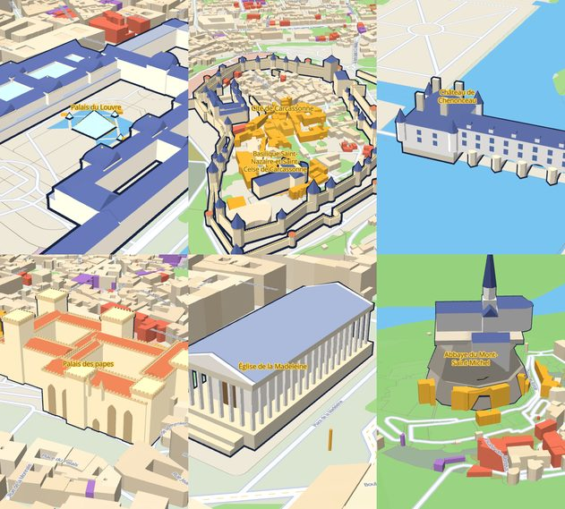
- **Sept monuments de Paris de plus** (nuit du 4 nov.) : **le Grand Palais** (la verrière en berceau et ses arcs de fer, le dôme de verre, la colonnade, les quadriges de bronze, le palais de la Découverte et sa rotonde), **le pont Alexandre-III** (l'arche d'acier très plate, ses guirlandes dorées, les quatre pylônes et leurs Pégase dorés, les lampadaires), **le Pont-Neuf** (sept arches puis cinq, les demi-lunes au-dessus des piles, la statue d'Henri IV), **la Conciergerie** (la tour Bonbec crénelée, les tours d'Argent et César et leurs toits pointus, la tour de l'Horloge et son horloge bleue et or), **le Palais-Royal** (la cour d'honneur et les colonnes noires et blanches de Buren, la galerie d'Orléans, les galeries du jardin et leurs arcades, les tilleuls, le bassin), **la place des Vosges** (36 pavillons de brique et de pierre, leurs hauts toits d'ardoise, le jardin, les fontaines, Louis XIII), **Saint-Sulpice** (la façade à deux étages de colonnes, les deux tours rondes). Les ponts n'ont pas de bâtiment dans la BD TOPO : leurs berges sont relevées sur la carte (là où l'eau commence le long de l'axe du pont).
- **Vérifier le volume sous les pièces réunies** : une forme réunie (les pavillons de la place des Vosges) a une seule grande boîte ; la vérification lance un rayon vertical sous chaque point des bâtiments de l'IGN pour savoir s'il passe sous la maquette.

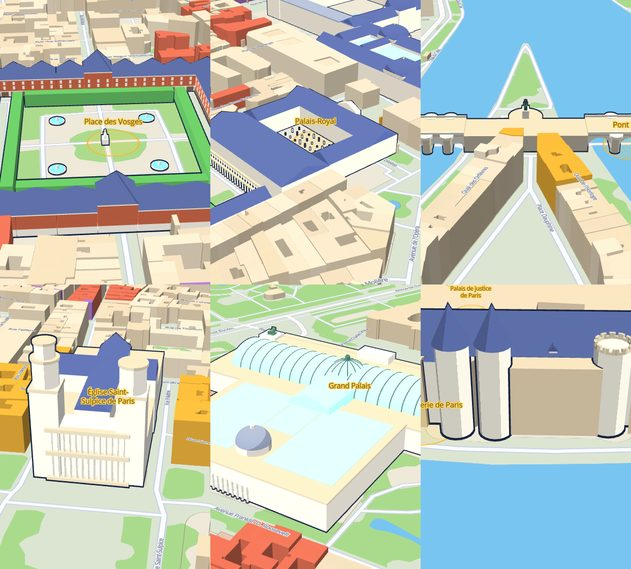
- **Sept monuments de plus** (nuit du 4 nov.) : **Vaux-le-Vicomte** (le dôme du grand salon ovale, les hauts toits, les douves ; la BD TOPO ne dessine pas le château : il est posé au point de Wikidata, la cour au nord, les jardins au sud), **Vincennes** (l'enceinte crénelée et ses tours, la tour du Village, le donjon de 50 m et ses tourelles dans son châtelet, la Sainte-Chapelle, les pavillons du Roi et de la Reine), **Blois** (les ailes Gaston d'Orléans, François Ier et sa façade des Loges, Louis XII en brique, la chapelle), **Amboise** (le logis du Roi et ses lucarnes, la tour des Minimes, la chapelle Saint-Hubert), **le château d'If** (le donjon carré et ses trois tours crénelées), **Notre-Dame-de-la-Garde** (sur son fort, la basilique aux pierres blanches et vertes, ses coupoles, la Vierge dorée), **le viaduc de Millau** (2 460 m le long de l'A75 relevée sur la carte, ses piles fendues, ses pylônes et ses haubans jaunes ; la carte est plate : le tablier est à 100 m au lieu de 270 m au-dessus du Tarn).

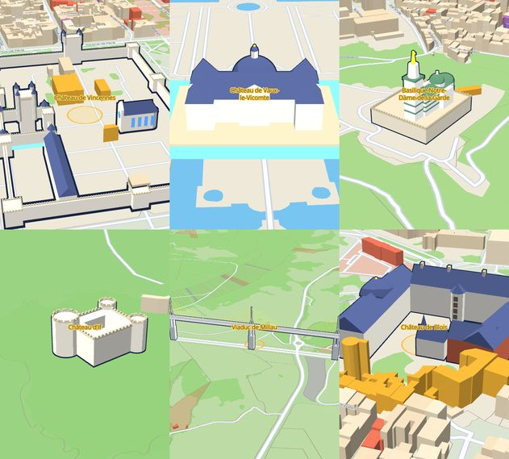
- **Les onze derniers monuments nationaux** (nuit du 4 nov.) : les cathédrales de **Bourges** (sans transept, deux étages de bas-côtés, doubles arcs-boutants, deux tours), **Beauvais** (le chœur le plus haut, sans nef, ses rosaces), **Nantes** (la nef de 37,5 m, les deux tours plates), la basilique de **Vézelay** (nef romane, narthex, tour Saint-Michel, chœur gothique, toits de tuiles), ce qui reste de **Cluny** (le bras du grand transept et le clocher de l'Eau-Bénite), l'abbaye de **Fontenay** (église cistercienne, cloître, forge), la chapelle de **Ronchamp** (murs blancs, toit en coque, tours, fenêtres de couleur), **la Maison carrée** (temple romain), le **théâtre d'Orange** (le mur de scène et ses arcades, les gradins en demi-cercle), le **pont d'Avignon** (quatre arches, la chapelle Saint-Nicolas, le châtelet ; tracé d'après la BD TOPO), les **alignements de Carnac** (dix files de menhirs, une représentation : la BD TOPO ne donne pas les pierres). Le modèle de cathédrale accepte une église sans transept. Pas de maquette (halo doré) : les grottes, les cimetières, les jardins, et le Ritz (une marque : question posée à Gautier).

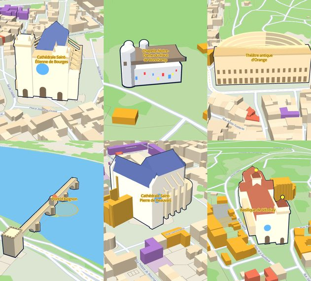
- **Les monuments régionaux, les plus connus d'abord** (nuit du 4 nov.) : **Montsoreau** (le logis de tuffeau au bord de la Loire), **Saint-Germain-en-Laye** (le pentagone de brique et ses terrasses), **Saint-Savin-sur-Gartempe** (la flèche de 77 m), **la Saline royale d'Arc-et-Senans** (la maison du directeur et ses colonnes, le demi-cercle), **Saint-Eustache**, **le palais de Chaillot** (les pavillons, les ailes en arc, les statues dorées), **la place Stanislas** (l'hôtel de ville, les pavillons, les grilles dorées), **la cathédrale de Laon** (le chevet plat, les tours à étage octogonal ; le modèle de cathédrale accepte un chevet plat). Pas de maquette pour les sites sans bâtiment (jardins, sites archéologiques, camps, cimetières) ; l'obélisque de Louxor est déjà dans la Concorde.

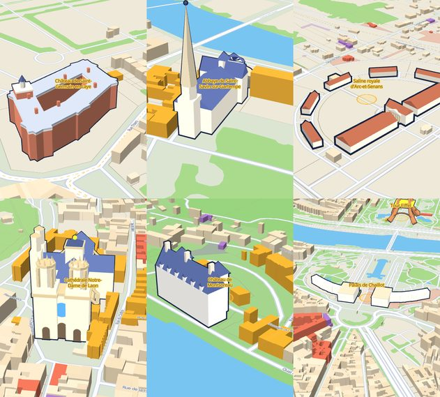
- **Dix monuments régionaux de plus** (nuit du 4 nov.) : **Fontevraud** (l'abbatiale et ses coupoles, le grand cloître, les cuisines romanes et leurs cheminées coniques), **le palais du Tau**, **Azay-le-Rideau** (sur l'Indre, ses tourelles), **le phare de Cordouan** (ses étages Renaissance, sa lanterne), **Villandry**, **la grande coupole de l'observatoire de Nice**, **la cathédrale d'Albi** (la forteresse de brique, ses contreforts ronds, le clocher de 78 m, le baldaquin blanc), **l'École militaire** (le pavillon central et son dôme carré), **le théâtre des Champs-Élysées**, **le Clos Lucé** (brique rose, tourelle d'escalier).

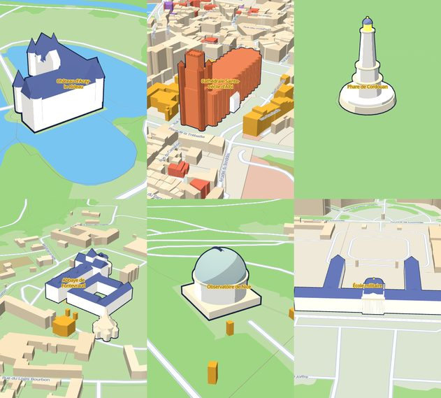
- **Six monuments régionaux de plus** (nuit du 4 nov.) : **l'Odéon**, **Chantilly** (le Grand Château en triangle sur l'eau, ses tours, la chapelle), **Angers** (l'enceinte et ses quatorze tours rayées de schiste et de tuffeau), **Bayeux** (les deux flèches, la tour-lanterne et son dôme vert), **l'arc antique d'Orange**, **la villa Savoye** (la boîte blanche sur ses pilotis). Pas de maquette pour Chinon (trois châteaux en ruine, à faire d'après ses murs), Cîteaux et Clairvaux (vestiges dispersés, prison), la synagogue de Besançon.
- **Les maquettes sont construites à la demande** : une maquette n'est construite que quand son monument approche de l'écran (la construction de toutes au démarrage prenait 0,3 s sur le PC à 71 maquettes, bien plus sur un téléphone, et toute leur mémoire).

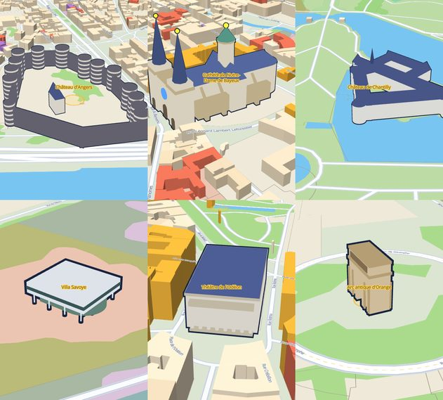
- **Dix monuments régionaux de plus** (nuit du 4 nov.) : **Saint-Remi de Reims**, **Saint-Germain-l'Auxerrois** (le porche flamboyant), **la tour Saint-Jacques**, **les arènes de Lutèce**, **le château de Saumur** (ses tours et leurs girouettes dorées ; posé au point de Wikidata), **la place des Victoires** (le cercle des façades, Louis XIV doré), **le Haut-Kœnigsbourg** (le grès rose sur son rocher, le bastion, le donjon, les toits de tuiles), **Saint-Étienne-du-Mont** (la façade aux trois pignons), **les arènes de Nîmes** (l'ellipse, ses deux étages d'arcades, les gradins), **la colonne de Juillet** (le Génie de la Liberté doré).

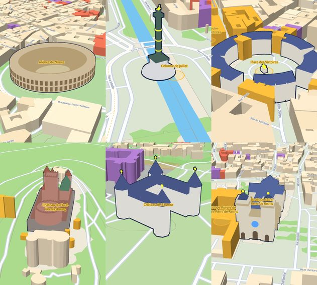
- **Dix monuments régionaux de plus** (nuit du 4 nov.) : **Pierrefonds** (huit grosses tours et leurs toits pointus), **la primatiale Saint-Jean de Lyon** (toit bas de tuiles, tours carrées), **la Major de Marseille** (pierres blanches et vertes, coupoles), **la porte Saint-Denis**, **la colonne Vendôme** (Napoléon au sommet), **le trophée des Alpes**, **le Lion de Belfort** (le lion de grès rouge couché devant sa paroi de rocher), **Ussé** (le château de la Belle au bois dormant, ses tourelles), **le pont Mirabeau** (ses arches d'acier et ses quatre statues de bronze), **Notre-Dame de Fourvière** (quatre tours octogonales, la Vierge dorée).

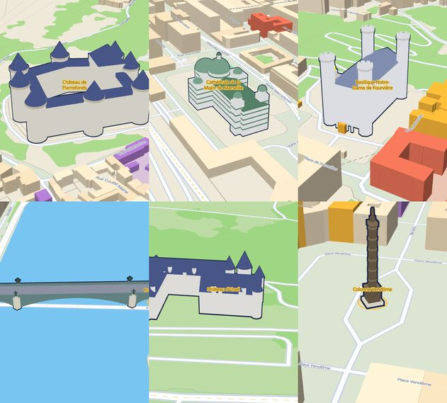
- **Dix monuments régionaux de plus** (nuit du 4 nov.) : **le donjon de Loches**, **Château-Gaillard** (le donjon et l'enceinte en ruine), **Langeais**, **Saint-Sernin de Toulouse** (la brique rose, le clocher octogonal à cinq étages), **Sainte-Clotilde** (ses deux flèches), **Saint-André de Bordeaux** (les flèches du portail nord, la tour Pey-Berland et sa Vierge dorée), **Saint-Étienne de Metz** (la pierre de Jaumont dorée, les grandes verrières, la tour de Mutte), **la cathédrale de Clermont-Ferrand** (la pierre noire de Volvic, ses flèches), **Cheverny** (les dômes carrés), **le viaduc de Garabit** (l'arc de fer rouge d'Eiffel au-dessus de la Truyère, le long de la voie ferrée relevée sur la carte ; tablier à 70 m : la carte est plate).

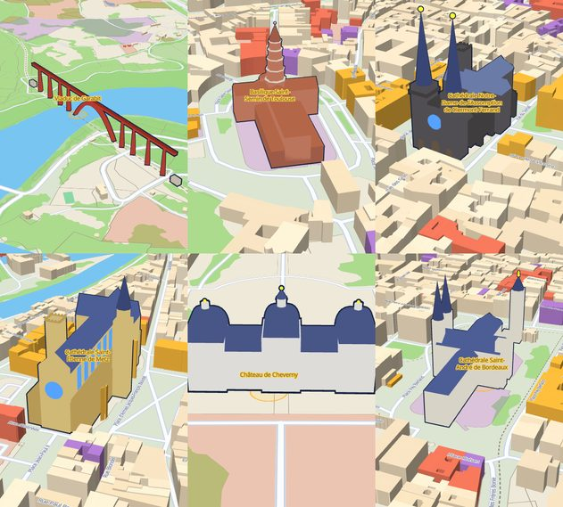
- **Dix monuments régionaux de plus** (nuit du 4 nov.) : **l'Institut de France** (la coupole et ses côtes dorées, les ailes en arc face à la Seine), **Saint-Gervais** (la façade aux trois ordres de colonnes), **Chaumont-sur-Loire**, **Valençay** (le dôme carré du grand pavillon), les cathédrales d'**Orléans** (les tours couronnées, la flèche de la croisée), de **Sens** et de **Tours** (les lanternes Renaissance), **Notre-Dame-des-Doms d'Avignon** (la Vierge dorée sur le clocher), **Saint-Front de Périgueux** (cinq coupoles et leurs lanternons, le haut clocher), **Sully-sur-Loire** (le donjon dans ses douves). Pas de maquette pour Maxim's (une enseigne, comme le Ritz).

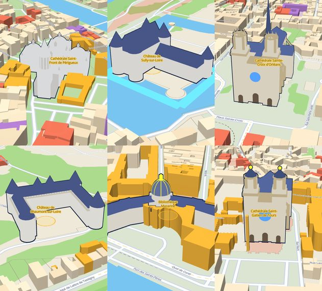
- **Dix monuments régionaux de plus** (nuit du 4 nov.) : les cathédrales de **Limoges**, **Sarlat**, **Noyon** et **Le Mans** (le chœur géant et sa forêt d'arcs-boutants), **Saint-Benoît-sur-Loire** (la tour-porche), **le château de Foix** (ses trois tours sur le rocher), **Saint-Augustin** (le dôme de Baltard), **le Capitole de Toulouse** (la façade de brique rose et ses colonnes de marbre), **l'abbaye de Sénanque** (et son champ de lavande), **la cathédrale Saint-Alexandre-Nevsky** (ses bulbes dorés).

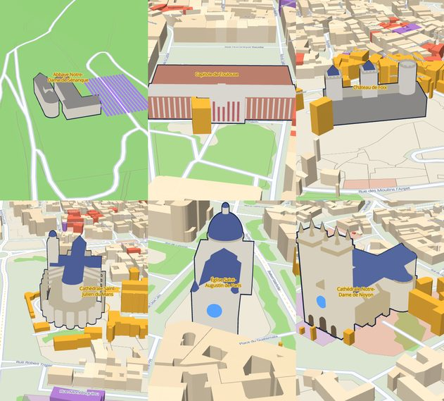
- **Douze monuments régionaux de plus** (nuit du 4 nov.) : **Saint-Pierre de Montmartre**, **le château de Brissac** (le plus haut château de la Loire), **le pont Royal**, **la Sainte-Trinité** (son clocher-porche sur le square), les cathédrales d'**Autun** (la flèche de la croisée), de **Dijon** (les toits vernissés), d'**Angoulême** (la façade romane et ses coupoles), de **Narbonne** (le chœur géant inachevé), **Saint-Trophime d'Arles**, **le château des ducs de Bretagne** (l'enceinte et ses tours dans les douves), **Castelnaud** (sur la Dordogne), **les arènes d'Arles** (et leurs tours médiévales).

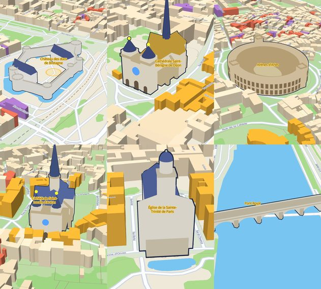
- **Douze monuments régionaux de plus** (nuit du 4 nov.) : les églises **Saint-Merri**, **Saint-Séverin** (son double déambulatoire), **Saint-Roch** (la façade à colonnes, la coupole de la chapelle de la Vierge) et **Saint-Vincent-de-Paul** (ses deux tours sur la grande terrasse), les cathédrales de **Quimper** (les deux flèches de pierre), de **Troyes** (la tour Saint-Pierre, la grande rose) et **Saint-Étienne de Toulouse** (la nef de brique et le grand chœur sur un autre axe), **la porte Saint-Martin**, **la chapelle de la Salpêtrière** (la croix grecque et son dôme), **la synagogue de Besançon** (ses petits dômes), **la forteresse de Chinon** (l'enceinte sur l'éperon, le logis royal, la tour de l'Horloge), **le château de Coucy** (ses quatre grosses tours). L'obélisque de Louxor n'a pas de maquette à lui : celle de la place de la Concorde le dessine déjà.

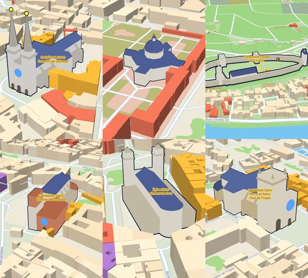
- **Douze monuments régionaux de plus** (nuit du 4 nov.) : **Saint-Julien-le-Pauvre**, **Saint-Nicolas-du-Chardonnet**, **le baptistère Saint-Jean de Poitiers**, **les châteaux de Beynac** (le donjon au bord de la falaise) et **de Pau** (le donjon de brique de Gaston Fébus), **l'abbaye aux Hommes de Caen** (les deux flèches et la tour-lanterne), **Saint-Michel d'Aiguilhe** (la chapelle perchée sur son aiguille de lave de 80 m), les cathédrales d'**Auch**, de **Rennes** (la façade de granit) et d'**Angers** (les deux flèches et la tour Renaissance), **le pont Marie**, **le palais des ducs de Bourgogne** (la tour Philippe le Bon).

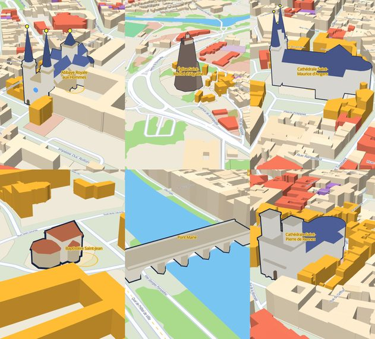
- **Douze monuments régionaux de plus** (nuit du 4 nov.) : les cathédrales de **Blois** (la lanterne Renaissance), **Vannes** (sa rotonde), **Poitiers** (l'église-halle au chevet plat), **Montpellier** (le porche aux deux piliers coniques), **Soissons**, **Saint-Louis de Versailles** (le dôme et les lanternes) et **Rodez** (le grès rose, le clocher de 87 m), **le Val-de-Grâce** (le dôme et ses côtes dorées), **Saint-Michel de Bordeaux** (et sa flèche de 114 m, isolée sur la place), **Notre-Dame-des-Victoires**, **la grande synagogue de la Victoire**, **la fontaine des Innocents**.

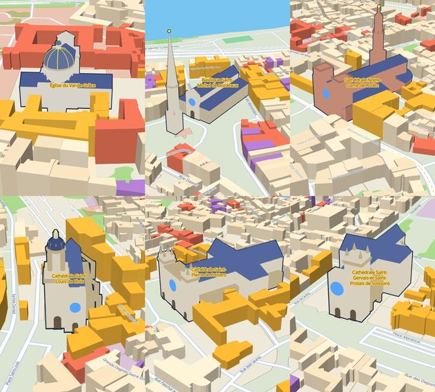
- **Douze monuments régionaux de plus** (nuit du 4 nov.) : les églises **Saint-Paul-Saint-Louis** (la façade jésuite et le dôme), **Notre-Dame-de-Lorette** (le portique), **Saint-Jean de Montmartre** (la brique), **Saint-Urbain de Troyes** (sa fine flèche), les cathédrales de **Senlis** (la flèche de 78 m) et de **Meaux** (la tour nord, la tour sud coiffée d'ardoise), **Sainte-Foy de Conques** (les flèches de pierre et les toits de lauzes), **l'abbaye aux Dames de Caen**, **le château de Châteaudun** (le grand donjon rond), **les hôtels de Sens** (les tourelles) **et de Sully**, **la chapelle expiatoire** (sa coupole et les galeries autour du jardin).

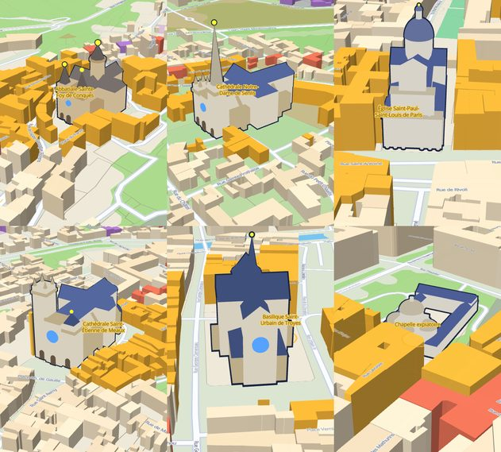
- **Douze monuments régionaux de plus** (nuit du 4 nov.) : les cathédrales de **Coutances** (les deux flèches et la tour-lanterne), **Auxerre**, **Bayonne**, **Béziers**, **Nevers** (ses deux absides) et **Toul** (les lanternes octogonales), **Saint-Ouen de Rouen**, **les Hospices de Beaune** (les toits de tuiles vernissées à bandes de couleur, la fine flèche), **les châteaux de Gien** (la brique) **et de Falaise** (les donjons et la tour Talbot), **l'ossuaire de Douaumont** (la galerie voûtée et sa tour), **Saint-Thomas de Strasbourg** (le grès rose).

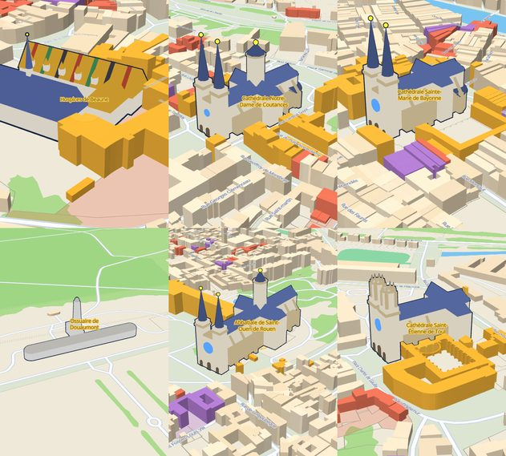
- **Onze monuments régionaux de plus** (nuit du 4 nov.) : **le pont Valentré** (ses six arches et ses trois tours), **Saint-Joseph du Havre** (la tour-lanterne de béton de 107 m), **le mémorial de Vimy** (ses deux pylônes), **Notre-Dame-la-Grande de Poitiers**, les cathédrales **du Puy-en-Velay** (les coupoles, le clocher à étages) et **de Cahors** (les deux grandes coupoles), **Saint-Maclou de Rouen**, **les Jacobins de Toulouse** (la brique, le clocher octogonal), **le phare d'Ar-Men** (en pleine mer), **le château de Vitré** (l'enceinte triangulaire et ses tours), **la basilique de Lisieux** (le grand dôme). La basilique Saint-Nazaire de Carcassonne n'a pas de maquette à elle : celle de la Cité la dessine déjà.

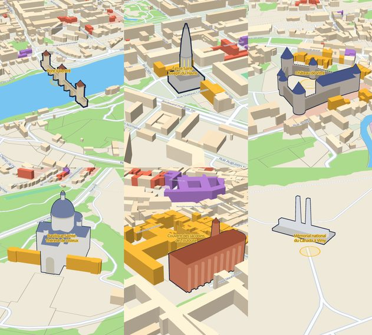
- **Douze monuments régionaux de plus** (nuit du 4 nov.) : **le palais de la Légion d'honneur** (la rotonde, la cour d'honneur), **le Grand-Théâtre de Bordeaux** (le portique aux douze colonnes et ses statues), **la cathédrale orthodoxe Saint-Nicolas de Nice** (ses bulbes verts et dorés), **le palais Rohan de Strasbourg**, **l'hôtel de ville de Lyon** (son beffroi à dôme), **Saint-Nicolas-des-Champs**, **le couvent de La Tourette** (le béton de Le Corbusier, les pilotis), les cathédrales d'**Arras** (blanche et classique), d'**Évreux** (la flèche d'argent), de **Perpignan** (la cage de fer de la cloche), de **Moulins** (les deux hautes flèches) et de **Langres**.

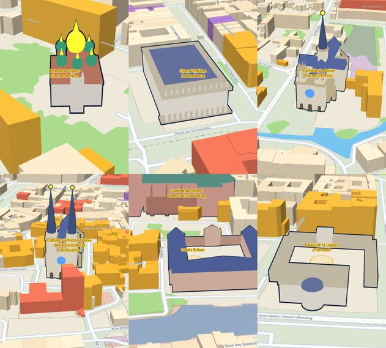
- **Douze monuments régionaux de plus** (nuit du 4 nov.) : **la basilique de Saint-Quentin** (ses deux transepts), les cathédrales de **Nancy** (les tours à lanternes, la coupole), **Lisieux**, **Montauban** (blanche et classique), **Agen**, **Cambrai**, **Saint-Brieuc** (la cathédrale-forteresse), **Sées** (les deux flèches), **Saint-Malo** (la haute flèche de la croisée) et **Agde** (la forteresse de basalte noir), **l'abbatiale de Tournus**, **Saint-Pierre de Caen** (son clocher et sa flèche).

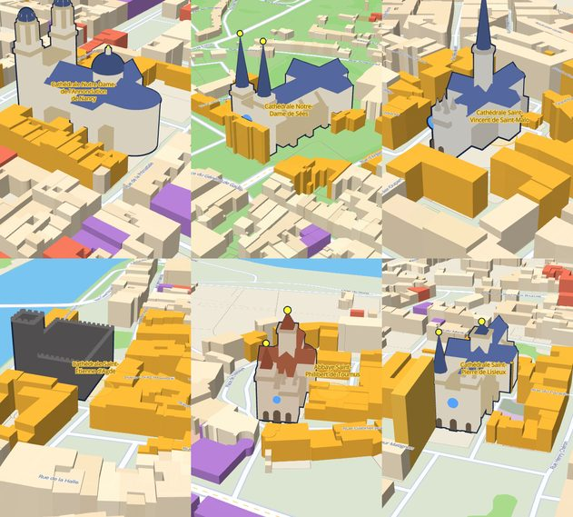
- **Douze monuments régionaux de plus** (nuit du 4 nov.) : **le musée d'Orsay** (la grande verrière, les pavillons, les horloges sur la Seine), **le mémorial de Thiepval** (l'arc de brique en gradins), **le Gros-Horloge de Rouen** (le beffroi, le cadran doré), **la porte des Allemands de Metz** (le château-pont sur la Seille), les châteaux de **Tarascon** (la forteresse au bord du Rhône), **Josselin** (ses trois tours sur l'Oust), **Hautefort** (ses dômes) et **d'Annecy**, **la forteresse de Salses**, **le fort la Latte**, les cathédrales de **La Rochelle** et de **Vienne**.

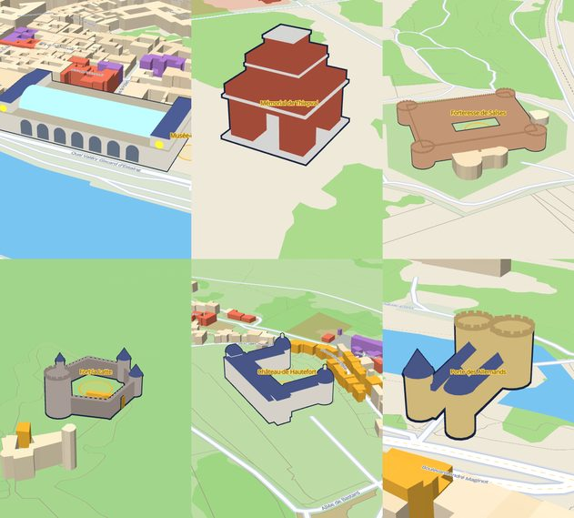
- **Douze monuments régionaux de plus** (nuit du 4 nov.) : **Saint-Paul de Strasbourg** (les deux flèches de grès rose sur l'Ill), **la collégiale de Colmar** (son toit vernissé, sa tour), **Notre-Dame de Dijon**, **la Trinité de Vendôme** (et son clocher isolé), **la cathédrale de Verdun**, **la basilique de Saint-Nicolas-de-Port** (ses deux tours à dômes), les châteaux de **Bonaguil**, **Montreuil-Bellay**, **Maintenon** (la brique, le donjon, les tours) et **Sceaux**, **le temple du Marais** (le dôme de Mansart), **le théâtre antique de Lyon** (ses gradins).

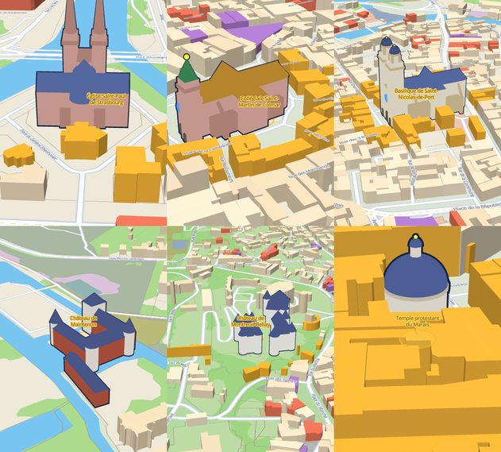
- **Onze monuments régionaux de plus** (nuit du 4 nov.) : les châteaux de **Caen** (la grande enceinte, tracée d'après les murs de l'IGN), **Dinan** (le donjon aux deux tours), **Anet** (la chapelle à dôme, le portail) et **Écouen** (les quatre ailes et leurs pavillons), **l'abbaye de Moissac** (le clocher-porche et le cloître), les cathédrales d'**Ajaccio**, de **Saintes** (le grand clocher et son dôme), de **Bazas** et **Sainte-Réparate de Nice** (son dôme vernissé), **l'arc de Germanicus**, **Saint-Michel de Carcassonne**.

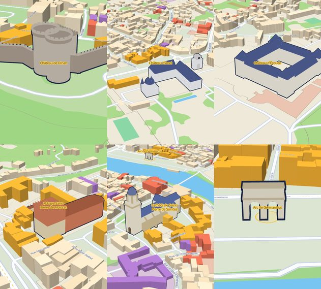
- **Onze monuments régionaux de plus** (nuit du 4 nov.) : **la cathédrale d'Aix-en-Provence** (son clocher octogonal, son baptistère), les châteaux de **Maisons** (Mansart), **du Plessis-Bourré** (dans ses larges douves), **de Talcy** (son colombier), **de Roquetaillade** (le donjon et les tours pointues) et **d'Abbadia**, **l'abbaye Saint-Victor de Marseille** (l'église fortifiée), **la basilique de la Daurade**, **la grande synagogue** et **la basilique Saint-Seurin de Bordeaux**, **la cathédrale de Valence**.

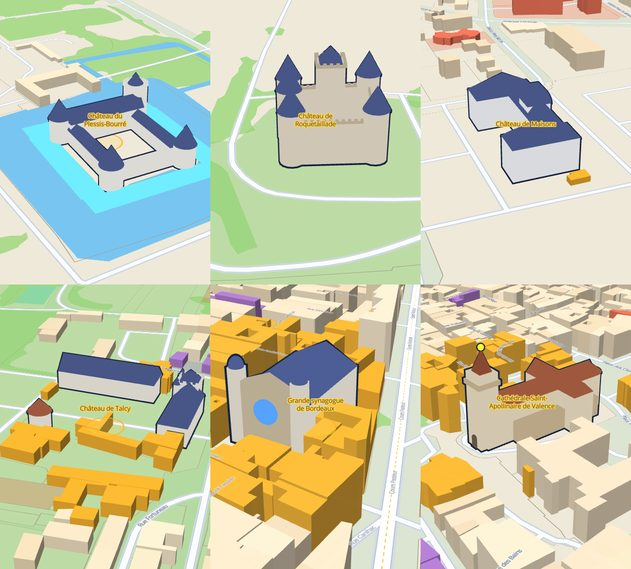
- **Onze monuments régionaux de plus** (nuit du 4 nov.) : les châteaux cathares de **Quéribus** et de **Montségur** (sur leurs pitons rocheux), les abbayes de **Jumièges** (ses ruines : les deux tours, la nef à ciel ouvert), **Murbach** (ses deux tours de grès rose), **Pontigny** (la longue abbatiale cistercienne), **Corbie** et **du Thoronet**, **la cathédrale d'Oloron**, **le fort de Brégançon** (sur son rocher), **la tour Clovis** (l'ancienne abbaye Sainte-Geneviève), **le château de Ferrières** (ses tours d'angle, sa verrière). Jumièges et Montségur n'ont pas de bâtiment dans l'IGN : posés d'après le point du monument.

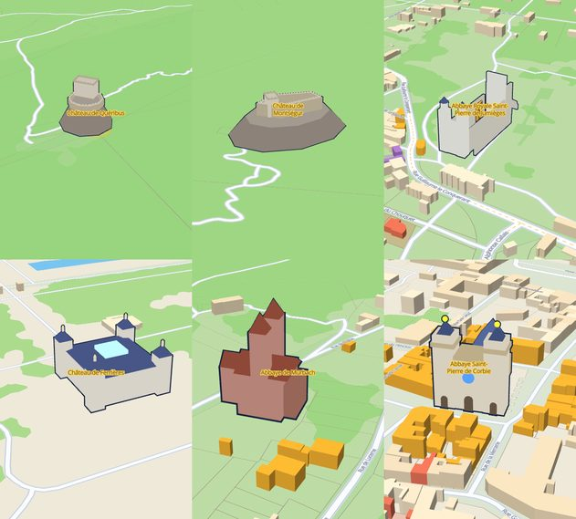
- **Dix monuments régionaux de plus** (nuit du 4 nov.) : les châteaux de **Serrant** (ses tours à dômes), **Ancy-le-Franc** (le carré Renaissance), **Fénelon** (les toits de lauzes), **Saché**, **Menars** (la longue façade sur la Loire), **du Rivau** et **de Beauregard**, **la cathédrale de Lescar**, **Notre-Dame-de-Bonne-Nouvelle**, **la fontaine Médicis** (tournée vers son bassin). 301 maquettes : la barre des 300 est passée.

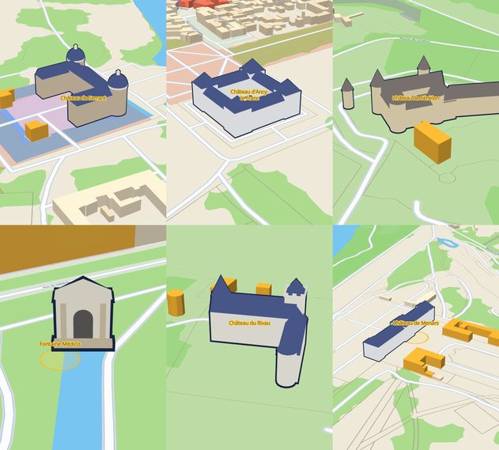
- **Sept monuments régionaux de plus** (nuit du 4 nov.) : **la cathédrale de Besançon** (ses deux absides, son clocher à l'impériale), **l'observatoire de Meudon** (la grande coupole), les églises **Saint-Médard**, **Saint-Eugène-Sainte-Cécile** et **Sainte-Élisabeth-de-Hongrie**, **le théâtre antique d'Arles** (ses gradins et ses « deux veuves »), **la salle du Jeu de paume** de Versailles.

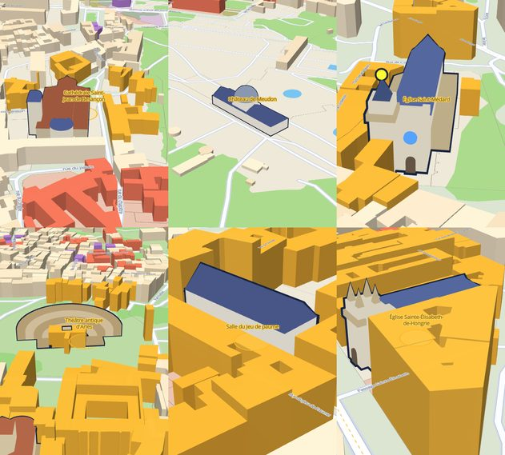
- **Neuf monuments régionaux de plus** (nuit du 4 nov.) : **la porte de Mars** de Reims (ses trois arches), **la cathédrale de Châlons** (sa tour romane et sa flèche), **Notre-Dame-en-Vaux** (ses quatre clochers), **le temple d'Auguste et de Livie** à Vienne, **le château de Suscinio**, **le château de Fougères** (l'enceinte tracée d'après les murs de l'IGN, ses tours), **le palais Longchamp** (les ailes, la colonnade, le château d'eau), **le pont transbordeur de Rochefort** (les pylônes, le tablier à 50 m, la nacelle), **la cathédrale de Saint-Pol-de-Léon** (ses deux flèches de granit).

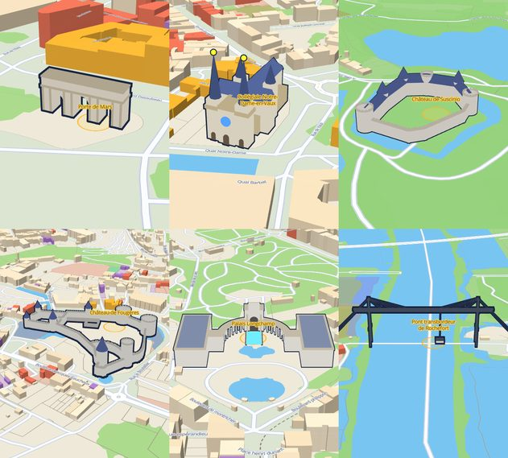
- **Sept monuments régionaux de plus** (nuit du 4 nov.) : **le musée de Picardie** (ses pavillons d'angle, la verrière), **le château de Najac** (son enceinte et son grand donjon rond), **Sainte-Croix de Bordeaux** (la façade romane et son clocher), **le château d'Ainay-le-Vieil** (l'enceinte octogonale et ses tours), **Saint-Pierre-le-Jeune** protestant à Strasbourg (le grès rose), **le château d'Azay-le-Ferron**, **Saint-Leu-Saint-Gilles** (ses deux petites flèches sur la rue Saint-Denis).

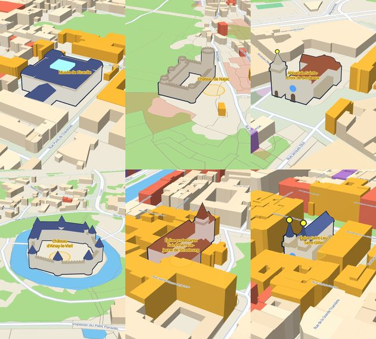
- **Huit monuments régionaux de plus** (nuit du 4 nov.) : **le château de Murol** (la forteresse de basalte sur sa butte), **Villesavin** (le logis bas et ses ailes, le colombier), **Montpoupon**, **Puymartin** (ses toits de lauzes), **La Brède** (au milieu de ses douves), **la cathédrale d'Antibes** (la façade ocre et la vieille tour de guet), **la cathédrale de Viviers** (le clocher-porche et son étage octogonal, le haut chœur), **l'abbaye de Chaalis** (le château des abbés et la chapelle).

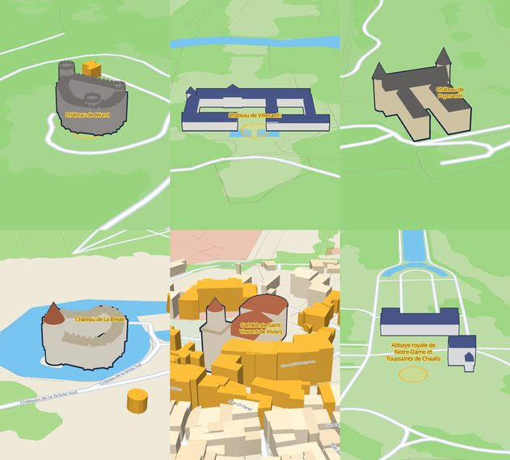
- **Huit monuments régionaux de plus** (nuit du 4 nov.) : les abbayes de **Fontfroide**, **Valmagne** (la grande abbatiale et ses deux tours), **l'Épau** et **Montmajour** (l'abbatiale, la tour de Pons de l'Orme, la ruine du monastère mauriste), **la cathédrale de Maguelone** sur son île, **la cathédrale de Lavaur** (la brique du gothique méridional, le clocher octogonal), **Saint-Paul-de-Mausole**, **le Pont-Vieux d'Albi** (ses arches sur le Tarn).

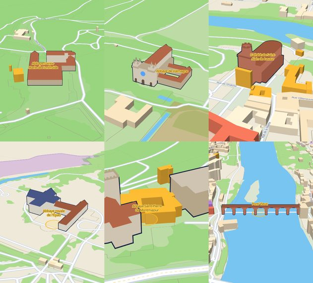
- **Dix monuments régionaux de plus** (nuit du 4 nov.) : **Châlus-Chabrol** (le donjon rond), **Puivert** (le grand donjon carré et l'enceinte), **Saint-Martin-du-Canigou** (l'abbatiale et sa tour crénelée), **Cadouin** (le clocher de lauzes), **Remiremont** (le clocher à bulbe lorrain), les châteaux cathares en ruine de **Puilaurens**, **Aguilar** et **Termes**, **l'abbaye de Beauport**, **le château de Commarque** : les ruines sont tracées d'après les murs de l'IGN.

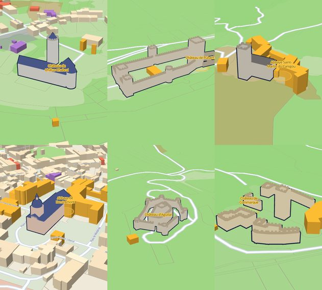
- **Cinq monuments régionaux de plus** (nuit du 4 nov.) : **les quatre châteaux de Lastours** sur leur crête, **Peyrepertuse** étirée sur la sienne (le château bas, le donjon de San Jordi), **les ruines de Clisson** (le donjon, la grande enceinte), tracés d'après les murs de l'IGN ; **la basilique de Luxeuil** (le grès rose, la tour-porche), **Saint-Michel-de-Cuxa** (le grand clocher roman).

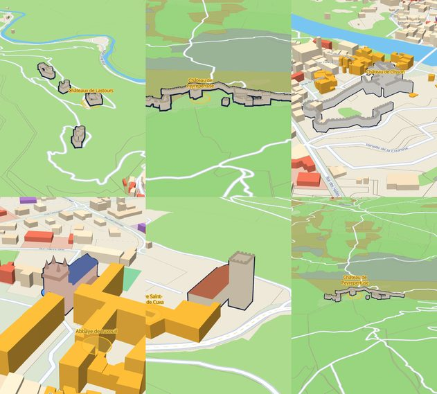
- **Quatre monuments régionaux de plus** (nuit du 4 nov.) : **la Grande Chartreuse** (le très long grand cloître et les petites maisons des moines), **le palais de Compiègne** (le grand triangle, la cour d'honneur, les longs toits d'ardoise), **l'abbaye Saint-Remi** de Reims (les bâtiments du musée contre la basilique), **le fort Saint-Jean** à Marseille (la tour du Roi René).

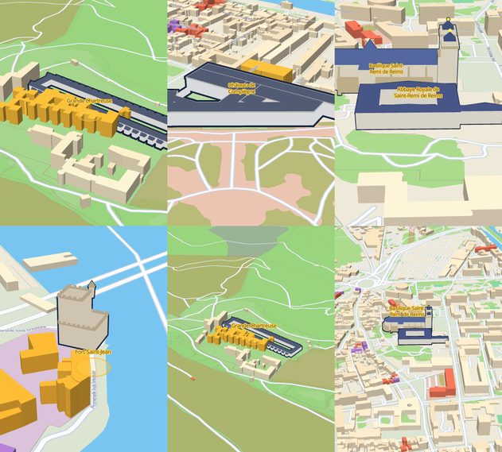
- **Six monuments régionaux de plus** (nuit du 4 nov.) : **l'abbaye de Gellone** à Saint-Guilhem-le-Désert, **la tour Saint-Nicolas du Bec-Hellouin**, **la villa Ephrussi de Rothschild** (la villa rose), et trois mégalithes posés au point du monument (l'IGN n'a pas de bâtiment) : **la Roche-aux-Fées** (l'allée couverte), **le cairn de Barnenez** (le tertre à gradins et ses onze couloirs), **le grand menhir brisé d'Er Grah** (ses quatre morceaux couchés).

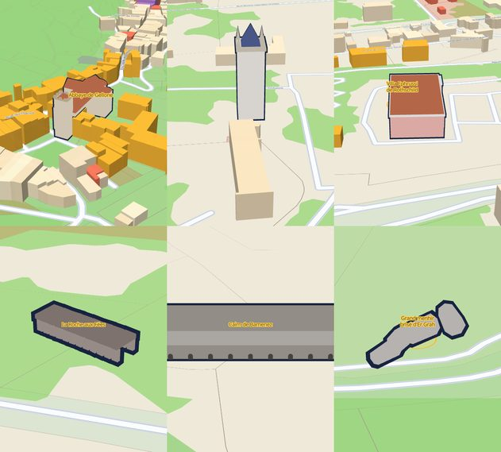
- **Trois monuments régionaux de plus** (nuit du 4 nov.) : **la chapelle de la Médaille miraculeuse** (rue du Bac), **l'hôtel de Matignon** (le corps de logis, les ailes, le portail), **la maison La Roche** de Le Corbusier (les volumes blancs, la galerie courbe sur pilotis).

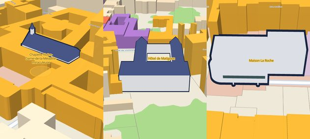
